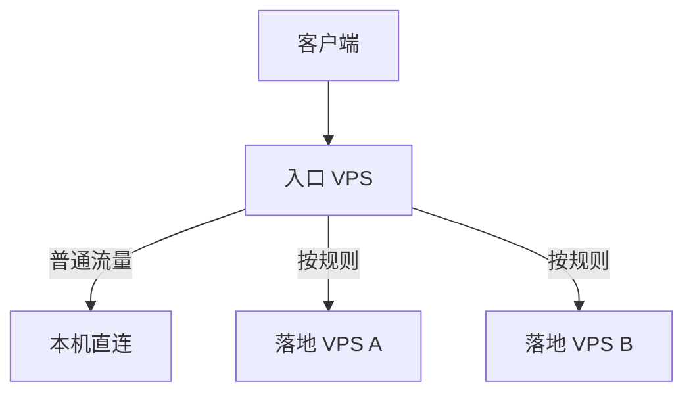

# sing-box Manager

面向 Debian / Ubuntu 的 sing-box 部署、节点管理、智能分流及维护工具。支持单 VPS、双 VPS 和多落地出站架构，不限制服务器所在地区。

**当前版本：v2.2.30** · 目标核心版本：sing-box 1.14.x · Bash / systemd

## 功能

- 独立代理、入口中转、落地服务三种初始化模式。
- Hysteria2、AnyTLS、VLESS REALITY 入站；落地机可选 SS2022。
- AnyTLS、Shadowsocks、Hysteria2、VLESS 多中转出站，自定义标签。
- 自定义域名、IP 网段及远程规则集分流，支持规则增删改、排序、启停。
- 27 项预设规则集选项，支持逗号多选，添加时检测下载可用性。
- 智能分流、全局直连、全局中转模式及分流配置导入导出。
- 独立临时客户端测试中转和路由，避免占用正式缓存数据库。
- 配置备份、JSON 校验、启动失败回滚、权限修复、日志监控。
- ANSI 彩色中文自适应双列菜单，窄终端自动使用单列，支持 NO_COLOR。
- 中文服务状态、核心版本和分流状态栏；第 35 项或 `sb self-update` 更新管理器。

## 安装

建议使用 Debian 12/13 或 Ubuntu 22.04/24.04，要求 root、systemd、可访问软件仓库和 GitHub。容器型 VPS 需具备运行 sing-box 的权限。

先切换到 root（已是 root 则跳过）：

```bash
sudo -i
```

下载安装管理器（生产环境建议先审阅下载的脚本）：

```bash
curl -fsSL https://raw.githubusercontent.com/xiaoxya/sb-manager/main/sb.sh -o /tmp/sb.sh
bash -n /tmp/sb.sh && bash /tmp/sb.sh install-manager
```

新服务器安装核心及依赖（含 Python 3，菜单需要它）：

```bash
sb update
sb
```

核心使用 https://sing-box.app/install.sh 官方安装程序，未锁定版本。升级核心前请检查兼容性。

已有服务器仅需执行管理器安装命令即可升级脚本；不要重新初始化现有节点。替换旧管理器时会询问是否备份。

## 部署模式

| 模式 | 快捷命令 | 说明 |
| --- | --- | --- |
| 独立代理 | `sb init-standalone` | 单 VPS，本机直连，不需要落地机 |
| 入口中转 | `sb init-entry` | 客户端入口，可选择立即配置中转或稍后添加 |
| 落地服务 | `sb init-landing` | 接收中转及普通客户端连接 |

### 单 VPS

```bash
sb init-standalone
sb info
sb status
```

输入公网 IP 或域名、内部监听端口、TLS SNI、REALITY 目标域名，并按提示选择启用的入站。

### 双 VPS / 多落地 VPS



先在每台落地机安装管理器和核心，然后执行：

```bash
sb init-landing
sb info
curl -4fsS https://api.ipify.org; echo
```

记录公网地址、映射端口、AnyTLS 的 `relay-client` 用户密码、TLS SNI、SHA256 Base64 公钥指纹及实际公网出口 IP。

在入口机执行：

```bash
sb init-entry
sb relay
sb test-route
```

初始化时可选择配置落地节点，并选择是否启用 AI / Crypto / Web3 / TikTok 预设分流。中转测试通过后才应用配置。若暂不配置中转，默认本机直连；之后使用 `sb outbounds` 添加节点，使用 `sb rules` 管理规则。

### 默认端口

| 入站协议 | 独立 / 入口 | 落地 |
| --- | --- | --- |
| Hysteria2 (UDP) | 443 | 21196 |
| AnyTLS (TCP) | 59007 | 59007 |
| VLESS REALITY (TCP) | 443 | 不提供 |
| SS2022 (TCP/UDP) | 不提供 | 18834（可选） |

端口均可在初始化时调整（SS2022 仅落地机可选）。NAT VPS 必须在供应商面板配置对应协议的公网端口映射。若公网端口不同于内部监听端口，客户端分享链接需手动修改为公网端口。脚本不会配置上游防火墙；建议仅开放实际使用的端口。

## 主菜单

执行 `sb`：

```text
01 安装/更新核心         17 时间同步
02 安装服务            18 系统诊断
03 启动                  19 前台调试
04 停止                  20 修复权限
05 重启                  21 备份
06 状态                  22 恢复 JSON
07 日志                  23 磁盘检查
08 节点信息              24 安全清理
09 修改监听端口          25 限制日志
10 出站节点管理          26 BBR 管理
11 修复规则下载          28 分流规则管理
12 中转测试              29 分流测试
13 日志级别              30 实时监控
14 REALITY 测试          31 域名统计
15 REALITY 公钥          32 AnyTLS 连接
16 TLS 目标              33 网卡速率
27 开机启动              34 公网地址
35 更新管理器
00 退出
```

## 出站节点管理

`sb outbounds` 或主菜单 10：

```text
01 查看出站详情       05 测试指定出站
02 添加出站           06 设置默认出站
03 修改出站           07 测试全部出站
04 删除出站           00 返回
```

添加节点时可使用 `relay-jp`、`relay-us` 等自定义标签，选择 anytls / shadowsocks / hysteria2 / vless，填写公网地址、端口及密码。TLS 协议需填写 SNI 和证书公钥指纹；HY2 可选 Salamander 混淆。输入预期出口 IP 可额外验证出口是否正确。

```bash
sb test-outbound relay-jp
sb test-outbound relay-jp 203.0.113.10
```

示例 IP 仅用于说明，请替换为真实出口。不能删除 direct；被活动配置或已保存策略引用的出站也不可删除。独立出站测试暂不支持链式 detour。

## 分流规则管理

`sb rules` 或主菜单 28：

```text
01 查看规则                13 设置默认出站
02 添加/修改/删除/排序规则  14 切换分流模式
05 启用/禁用规则           15 测试域名/IP
07 添加预设规则集          16 实时日志
08 自定义规则集管理        17 导入配置
                           18 导出配置
                           00 返回
```

02 和 08 进入同一个基础管理子菜单，支持查看、添加、修改、删除及排序规则，添加远程规则集、删除未引用规则集和设置默认出站。

### 自定义规则

| 匹配类型 | 示例 |
| --- | --- |
| domain | chatgpt.com |
| domain_suffix | openai.com |
| domain_keyword | netflix |
| domain_regex | ^api\\..* |
| ip_cidr | 203.0.113.0/24 |
| rule_set | geosite-ai |

多个匹配值使用英文逗号分隔。目标可选现有出站标签或 reject（拒绝）。规则索引从 0 开始，先匹配的终止规则优先。不要随意移除或移动基础嗅探、解析和私网拒绝规则；IP 匹配需注意域名解析位置。

例如将 Netflix 走日本出站：添加 domain_suffix 规则，匹配值 `netflix.com,nflxvideo.net,nflximg.net`，目标 `relay-jp`。

### 预设规则集

| 类别 | 选项 |
| --- | --- |
| AI | 01 AI 全部、02 OpenAI、03 Claude、04 Gemini |
| Crypto | 05 Crypto 全部、06 Binance、07 OKX、08 Web3 |
| 流媒体 | 09 TikTok、10 Netflix、11 YouTube、12 Disney+、13 Spotify、14 Twitch |
| 网络服务 | 15 Telegram、16 Twitter/X、17 Discord、18 GitHub、19 Google、20 Microsoft、21 Apple、22 Cloudflare |
| 其他 | 23 国外游戏、24 Speedtest、25 广告拦截、26 中国大陆域名、27 中国大陆 IP |

支持输入 `01,05,09` 批量选择同一目标出站，每项需确认。上游地址不可下载时会跳过；不保证全部预设在任何时刻均存在。重复添加可能产生重复路由规则，请先查看已有规则。

规则来源：[MetaCubeX/meta-rules-dat](https://github.com/MetaCubeX/meta-rules-dat)，默认更新周期 24h。

自定义远程规则集支持 HTTPS URL、binary (.srs) 或 source (.json) 格式。先添加唯一规则集标签，再添加 rule_set 匹配规则绑定目标出站。

### 分流模式

- smart：智能分流，恢复切换前保存的活动规则及默认出口。
- direct：全局本机直连。
- relay：全局指定中转出站。

切换全局模式保留基础嗅探、解析及私网拒绝规则。修改智能分流规则前应切回 smart。默认不配置中转失败时的自动直连回退。

### 导入 / 导出

导出包含 route.rules、route.rule_set、route.final 和策略元数据；默认文件为 /root/sb-routing-时间戳.json。

导入仅替换活动规则、规则集和默认出口，不导入禁用规则元数据，也不替换本机 DNS 或出站。迁移前应先配置对应出站标签及 HTTP Client，检查兼容性。导出的规则 URL 可能含访问令牌，请勿公开。

## 常用命令

| 命令 | 功能 |
| --- | --- |
| sb update | 安装 / 更新核心 |
| sb self-update | 从 GitHub 更新管理器（不更新核心或重启服务） |
| sb init | 初始化菜单 |
| sb init-standalone | 单机初始化 |
| sb init-entry | 入口初始化 |
| sb init-landing | 落地初始化 |
| sb start / stop / restart | 服务管理 |
| sb status | 服务状态 |
| sb logs | 实时日志 |
| sb info | 节点参数和分享链接 |
| sb port | 修改监听端口 |
| sb outbounds | 出站管理 |
| sb change-relay | 修改中转出站 |
| sb relay | 中转测试 |
| sb test-outbound 标签 [出口IP] | 指定出站测试 |
| sb rules | 分流管理 |
| sb test-route | 域名分流测试 |
| sb test | REALITY 本机测试 |
| sb monitor | 日志分类监控 |
| sb backup / restore | 备份 / 恢复 JSON |
| sb diagnose | 综合诊断 |
| sb fix-perm | 修复权限 |
| sb fix-rules | 修复规则下载配置 |
| sb disk / clean | 磁盘检查 / 清理 |

兼容旧命令 sb init-hk、sb init-tw。也可使用主菜单数字编号执行功能。

## 测试与监控

```bash
sb relay
sb test-route
sb monitor
```

分流测试创建独立临时 mixed 入站（127.0.0.1:10895）及缓存数据库，输入空格分隔的测试域名。输出 actual 为日志识别的出站标签，HTTP 为响应状态；policy=custom 不代表已自动判定预期规则。HTTP 000 表示未获得响应，401/403 可能是认证或服务端限制。临时入口可能影响入站相关规则匹配，最终以正式服务日志为准。

在落地机查看实时流量：

```bash
journalctl -u sing-box -n 0 -f -o cat
```

sb monitor 支持 all、ai、crypto、tiktok、anytls、relay-client（兼容 hk-relay）关键词过滤。用户名过滤取决于核心日志是否包含用户名。

菜单 31 统计历史连接目标出现次数（不是字节数），32 查看 AnyTLS TCP 连接，33 使用 nload 查看整张网卡流量。容器中无需强行使用 tcpdump。

## 配置与备份

```text
/usr/local/bin/sb
/etc/sing-box/
├── config.json
├── sb-host
├── sb-policy.json
└── cert/
    ├── fullchain.pem
    └── server.key
/var/lib/sing-box/cache.db
/root/sb-backups/
```

`sb backup` 备份 /etc/sing-box 整个目录；`sb restore` 仅恢复 config.json，证书、策略元数据和公网地址文件需手动核对恢复。配置修改会执行 sing-box check、备份、重启及失败时尝试回滚。备份包含敏感认证数据，务必妥善保存。

## 安全与已知限制

- 自签 ECDSA P-256 证书有效期 3650 天；已有完整证书会被复用。旧 privkey.pem 布局会阻止直接重新初始化。
- HY2/AnyTLS 分享链接使用 insecure=1 兼容部分客户端，建议手动配置公钥指纹校验；VLESS REALITY TCP 入站可生成完整分享链接，公钥由现有私钥计算。
- sb info 会显示认证信息，请勿公开输出或配置备份。
- 初始化会重新生成认证参数；已有 VPS 更新管理器时不要重新初始化。
- 当前版本不提供独立的入站增删菜单、规则名称、复杂组合规则、规则集强制更新或全面冲突检查。
- 目标为 sing-box 1.14.x，尚未完成真实多 VPS 联调及所有发行版验证。
- 清理日志、时间同步和前台调试可能影响系统其他功能或中断代理，请先阅读提示。
- 本仓库尚未声明开源许可证。

## 常见故障

```bash
sing-box check -c /etc/sing-box/config.json
sb status
journalctl -u sing-box -n 50 --no-pager
```

证书权限问题运行 sb fix-perm；规则下载配置问题运行 sb fix-rules；中转失败检查公网端口映射、密码、SNI、指纹和实际出口。不要在正式服务运行时使用相同缓存数据库启动第二个实例，使用 sb test-route 或菜单 19 前台调试。

## 项目链接

- [sing-box 官方文档](https://sing-box.sagernet.org/)
- [MetaCubeX 规则集](https://github.com/MetaCubeX/meta-rules-dat)
- [问题反馈](https://github.com/xiaoxya/sb-manager/issues)

## v2.2.1 界面与管理器更新

已有 v2.2.0 用户先按上方安装命令更新管理器；之后可执行 `sb self-update` 或选择主菜单 35。下载后执行 Bash 语法检查并提示备份替换。更新完成后退出旧菜单，再运行 `sb`。管理器更新不会主动修改代理配置或重启服务。

终端颜色默认自动检测，执行 `NO_COLOR=1 sb` 可使用纯文本菜单。终端宽度不足 90 列时自动使用单列。分流模式状态基于当前配置及保存的策略推断，不是实际流量测量。

## v2.2.2

`sb info`（菜单 08）新增 VLESS REALITY TCP 分享链接，自动读取 UUID、SNI、Flow、Short ID，并计算公钥。若公网端口与内部监听端口不同，请手动调整链接端口。未设置公网连接地址时先使用菜单 34 设置。非 TCP REALITY 暂不生成链接。

## v2.2.3

出站管理（菜单 10）新增 VLESS TCP REALITY 和 TLS。添加时输入 `vless`，填写服务器、端口、UUID、安全类型、Flow 和 SNI；REALITY 还需公钥、Short ID、uTLS 指纹。普通 TLS 使用系统证书验证。支持添加、修改、删除、测试和分流绑定；暂不支持 WS、gRPC、HTTPUpgrade 等非 TCP 传输，也不支持直接导入分享链接。应用前会执行原有中转测试及配置检查。

## v2.2.4 Snell 支持

新增 Snell 入站（服务端 v5/v6）和出站（客户端 v4/v6）。初始化三种模式时可选启用，也可在已有服务器通过 `sb add-snell`（现已整合到主菜单 02 → 05）追加 Snell 入站。默认 TCP 8443，需自行开放防火墙及 NAT 映射。节点信息显示 PSK 等连接参数，请勿公开。添加出站时选择 `snell`，配置 PSK、版本等参数，测试通过后再应用。v5 服务端可使用 v4 兼容客户端；不支持 v5 QUIC 模式。需要支持 Snell 的 sing-box 1.14.x 核心。尚未完成实机验证；分享链接导入见 v2.2.5。

## v2.2.5 分享链接导入

进入主菜单 10 → 08，或执行 `sb import-node`（别名 `sb import-outbound`）。输入唯一出站标签，再粘贴单条链接；认证信息不回显。支持 VLESS REALITY/TLS TCP/RAW、AnyTLS、Hysteria2 (`hy2://` / `hysteria2://`)、Shadowsocks/SS2022 (`ss://`，无插件)。支持 URL 编码、Base64 认证、IPv6 方括号地址及 HY2 Salamander 混淆。非 TCP VLESS、订阅链接、SS 插件和 Snell 分享链接暂不支持；Snell 仍可手动配置。

AnyTLS/HY2 可补充 Base64 SPKI SHA256 公钥指纹；若链接关闭证书验证且未修正，会要求风险确认。VLESS 拒绝关闭证书验证。解析结果隐藏密码和 UUID。可选填写预期出口 IP，连接测试成功后才提示应用，沿用配置检查、备份及失败回滚流程。新增出站不会自动修改分流规则。实际连接兼容性须在 VPS 验证。

## v2.2.6 安装服务与 BBR 管理

主菜单 02（`sb inbounds` / `sb install-service`）包含首次部署、查看入站、添加入站和删除入站。已有入站时菜单拒绝重新初始化。新增 HY2、AnyTLS、VLESS REALITY、SS2022、Snell 入站时保留其他节点及出站、路由；删除按标签操作，检查引用并至少保留一个入站。直接命令 `sb add-inbound`、`sb delete-inbound`。修改需确认，会校验配置、备份并重启服务；旧的直接初始化命令仍存在，不要在生产配置上误用。新证书可能在取消或失败后留存，删除入站不会删除证书。

主菜单 26 或 `sb bbr` 支持查看、启用 BBR + fq、恢复原运行时设置。持久化文件 `/etc/sysctl.d/99-sb-bbr.conf`，原设置记录 `/var/lib/sb-manager/bbr-original`。依赖内核支持和 sysctl 权限，容器可能无法修改；其他系统 sysctl 配置可能影响重启后的最终值。BBR 仅影响 TCP。当前尚未完成实机测试。

## v2.2.7

移除主菜单 36 的独立 Snell 入站添加选项，统一通过 02 安装服务 → 05 添加协议入站 → snell 管理。保留 `sb add-snell` 快捷命令兼容旧用法。

## v2.2.9 帮助与出站导出

`sb --help` / `sb -h` / `sb help` 查看命令帮助，`sb --version` / `sb -v` 查看版本，均无需 root。菜单 08 / `sb info` 仅显示入站节点信息，不再附加出站配置。

菜单 10 → 09 或 `sb export-outbound`（别名 `sb export-node`）导出单个或全部出站为原生 JSON 对象 `{"outbounds":[...]}`。默认路径 `/root/sb-outbounds-年月日-时分秒.json`，不覆盖已有文件，权限 600。导出包含认证信息，需确认并妥善保存。该文件并非完整 sing-box 配置，也不能直接通过分享链接导入菜单导入。导出不修改运行配置或重启服务。

## v2.2.10 出站分享链接优先导出

菜单 10 → 09 或 `sb export-outbound` 支持单个或全部出站。优先生成 VLESS REALITY/TLS TCP、AnyTLS、Hysteria2、Shadowsocks/SS2022 分享链接，并使用内置导入解析器进行配置往返一致性检查；无法完整转换的节点（含 Snell、direct 或额外高级字段）回退至原生 JSON。输入路径前缀后按需生成 `.txt`（每行一条链接）及 `.json`（仅回退节点，格式 `{"outbounds":[...]}`）。文件权限 600，不覆盖已有文件，可确认后在终端显示分享链接。导出含认证信息，请妥善保管。默认链接格式的客户端兼容性尚未实机验证。导出不修改代理配置或重启服务。

## v2.2.11 环境检测与 Argo 固定隧道

`sb env` 查看操作系统、AMD64/ARM64 架构、内核、虚拟化、systemd、软件依赖、内存磁盘及 BBR 状态。核心安装前执行 Debian/Ubuntu、软件包架构及 systemd 检查。主菜单显示系统及 Argo 状态。

主菜单 36 或 `sb argo` 管理 Cloudflare 固定隧道。需要在 Cloudflare 控制台预先创建 remotely-managed Tunnel、获取 connector token，并添加公网 hostname 路由到 HTTP `http://127.0.0.1:18080`（或自行选择的本地端口）。脚本通过官方 APT 仓库安装 cloudflared，创建独立 VLESS WS 回环入站、随机 UUID、WS 路径及 `sb-argo.service`，令牌保存在 `/etc/sb-argo/token`（600）。菜单可查看链接、启停、日志及删除本地配置。删除不会删除云端隧道。普通 HTTP Tunnel 不承载 REALITY、HY2、AnyTLS、Snell 或 SS 原生协议。本版不含临时 Quick Tunnel、云端 DNS 自动创建或 WS 出站分享链接导入。应用入站会重启 sing-box；连接器启动失败时可能保留已添加入站，需检查日志或删除。尚未进行 ARM64/Argo 实机验证。

## v2.2.13 管理器自动重载

主菜单 35 更新成功后由父进程执行 exec 自动加载新版，无需退出再运行 sb。交互式 `sb self-update` 同样自动打开新版菜单；非交互环境成功后正常返回。下载、版本标识、Bash 语法、暂存及备份检查通过后才使用同目录原子替换，取消或失败保留原文件。磁盘已有新版而当前运行版本较旧时直接重载。首次从旧版升级到 v2.2.13 仍可能需要手动退出重开一次，因为旧版尚未具备重载逻辑。不修改 sing-box 核心或代理配置，不重启服务。

## v2.2.14 公网地址自动检测

初始化及菜单 34（`sb public-address`）自动检测 VPS 公网出口 IP，优先 IPv4，失败时尝试 IPv6；使用多个 HTTPS 接口、请求超时及 IP 格式校验。首次安装以检测结果为默认，已有保存地址优先保留，输入 `auto` 使用检测结果，也可手动指定 IP 或域名。检测绕过 curl 代理环境变量，但不代表能绕过系统透明代理。NAT VPS 的出口 IP 不一定是入站连接地址，需以供应商分配的地址为准。菜单 34 仅修改分享链接使用的地址，不重启服务。

## v2.2.15 卸载管理器

主菜单底部新增 `99 卸载管理器`，与 `00 退出管理工具` 并列。快捷命令 `sb uninstall-manager` 或 `sb 99`，输入 `UNINSTALL` 确认后仅删除 `/usr/local/bin/sb` 并退出菜单。保留 sing-box 核心、运行服务、入站出站配置、证书、规则、BBR、Argo 和所有备份。上述为 v2.2.15 历史行为；从 v2.2.16 起，99 和 uninstall-manager 改为彻底卸载，请见下文。

## v2.2.16 彻底卸载服务（破坏性操作）

主菜单 99 改为彻底卸载服务，快捷命令 `sb uninstall-service` 或 `sb 99`；旧命令 `sb uninstall-manager` 也改为彻底卸载。必须输入 `PURGE` 确认。操作会停止 sing-box、sb-argo，卸载 sing-box 软件包、清理已知核心和 unit、删除配置、证书、缓存、管理器状态、默认导出文件及历史备份，最后删除管理器。恢复有记录的 BBR 原值并移除专用 journald 限额。cloudflared 在无其他用途且来源明确或经确认时卸载；若共享则保留及保留其软件源。系统时间同步服务单独询问确认；通用依赖、公共系统日志、云端 Tunnel/DNS 和自定义路径导出文件不强制清除。旧版本未记录所有软件安装来源，无法保证识别任意手工安装残留。卸载可能中断代理及依赖代理的 SSH，务必先独立连接并备份必要数据。失败不继续删除管理器；不保证整个卸载事务可回滚。尚未完成实机卸载测试。

## v2.2.17 Argo 网络与健康管理

新增固定隧道默认 `--edge-ip-version 4 --protocol auto`，基于 ARM VPS 上强制 IPv4 后四条 QUIC 连接成功注册的实测。菜单 36 新增 09 重启连接器、10 设置传输协议（auto/quic/http2）、11 设置边缘 IP 版本（auto/4/6）、12 网络环境检测（IPv4 TCP 7844 测试及当前进程 QUIC 预检查日志）、13 公网 VLESS WS TLS 端到端出口测试、14 IPv4 自动修复（IPv4 + auto）。启动验证使用本地 metrics 服务 `/ready`，尝试读取 HA 连接指标；历史注册连接数不等于实时连接数。若 metrics 不可用则报告健康未确认。网络参数通过 `network.conf` 覆盖，兼容已知手工配置，拒绝覆盖未知 ExecStart 或自定义内容；新配置健康检查失败时尝试恢复旧配置。单独删除 Argo 或彻底卸载时清理该已知覆盖文件，保留其他未知覆盖文件。仅更新管理器不会主动重启 Argo 或覆盖已有设置。公网测试不修改正式配置。新版管理逻辑尚未实机验证。

## v2.2.18 DNS 与 IPv6 管理

主菜单 37 或 `sb dns`：查看 DNS 配置、检测 IPv4/IPv6 公网 HTTPS、自动推荐解析策略、手动设置 ipv4_only/prefer_ipv4/ipv6_only/prefer_ipv6、设置 local/UDP/TCP DNS、系统 DNS 解析测试及查看近期 sing-box DNS 错误、恢复原始 DNS 配置。首次修改保存 `/var/lib/sb-manager/dns-original.json`，沿用配置备份、校验与应用失败回滚机制。保留出站专用 resolver，不禁用系统 IPv6，不拦截直接请求 IPv6 地址。设置服务器仅替换唯一的 local-dns 标签所对应的服务器；不提供 DoH/DoT 或多服务器配置。恢复 DNS 段及默认 resolver，并恢复仍匹配的 resolve 规则策略。自动检测仅反映检测端点当前可达性，应用前需要确认。更新管理器不会主动改变 DNS 或重启服务。新功能尚未 VPS 实机测试。

## v2.2.19 DNS 服务商预设及加密 DNS

菜单 37 → 08 新增系统 DNS、Cloudflare、Google、Quad9、AdGuard、阿里云、DNSPod、自定义预设，支持 UDP/TCP/DoH/DoT/DoQ/DoH3（按预设限制未确认支持的组合）。自定义支持 IPv4/IPv6 地址、端口、TLS SNI、HTTPS 路径，不接受完整 URL；加密 DNS 使用证书验证及 IP 直连以避免引导解析循环。可保存备用服务器 sb-dns-secondary，菜单 11 手动交换主备，不提供自动故障转移。菜单 12 通过临时 sing-box 实例分别测试主备 HTTPS 连通及总耗时并显示 DNS 日志，不是纯 DNS RTT。配置应用沿用备份、语法校验及回滚流程；已有备用标签时拒绝重复添加。更新管理器不重启服务，不改变 DNS 设置。尚未实机验证各协议及服务商组合。

## v2.2.20 菜单对齐及系统 IPv6 管理

统一双列菜单最小左列宽度为 36 个终端字符单元，保留中文宽度计算及窄终端单列显示，平衡 DNS 菜单两列。菜单 37 新增 13 系统 IPv6 状态、14 禁用系统 IPv6、15 恢复原始接口状态、16 启用系统 IPv6。首次操作记录 `/var/lib/sb-manager/ipv6-original.json`，写入 `/etc/sysctl.d/99-sb-ipv6.conf` 持久化配置，失败尝试恢复操作前的状态。彻底卸载时恢复有记录的 IPv6 设置。禁用操作需输入 DISABLE，可能中断 IPv6 SSH 及依赖 ::1 的服务；容器可能无权限，恢复开关后地址及路由可能需重新获取。存在无原始记录的同名配置时拒绝覆盖。此功能不修改内核启动参数，不自动调整 sing-box DNS 策略；其他系统配置或网络管理器可能覆盖 sysctl。更新管理器本身不改变网络或重启服务。尚未实机验证终端布局及 IPv6 启停。

## v2.2.21 IPv6 路由拒绝与一键 IPv4-only

菜单 37 新增 17 IPv6 拦截状态、18 拦截 IPv6 流量、19 解除 IPv6 拦截、20 一键 IPv4-only 模式。路由使用 `ip_version:6,action:reject,method:default,no_drop:true`，拒绝直接 IPv6 目标，仍可能产生正常拒绝日志。18/19 增删完全匹配的规则，不删除其他不同的 IPv6 规则；分流切换到全局模式时保留该规则，但导入/重建路由或恢复此前保存的智能分流规则可能覆盖它，需重新检查。20 需输入 IPV4ONLY，先校验配置，再禁用系统 IPv6、持久化 sysctl、设置 DNS ipv4_only 和路由拒绝；失败尝试恢复系统状态，配置沿用 apply 回滚。已有 IPv4 Argo 不主动重启，未指定 IPv4 时另行确认网络修复（不属于跨服务原子事务）。恢复通过 19 解除拦截、10 恢复首次 DNS 快照、15 恢复首次系统 IPv6 快照，Argo 参数在菜单 36 单独管理。出站专用 resolver 保留；不保证所有自定义配置、纯 IPv6 节点或代理链可用。请从 IPv4 SSH 操作。更新管理器本身不改变系统网络或服务配置。尚未实机测试。

## v2.2.22 Argo 稳定性诊断

主菜单 36 → 15 或 `sb argo-stability`：新增隧道日志事件统计（非实际断线次数）、近期 GoogleVideo CDN 直连 HTTPS 测试（非真实视频下载）、TCP 网络质量增量采样（非 QUIC 丢包率）、重复公网 VLESS 短请求测试（非持续长连接）、双服务实时日志，以及现有 QUIC/HTTP2 切换入口。诊断默认不改变正式配置或系统网络参数；协议切换需要确认并重启 Argo。尚未实机验证新菜单及诊断命令。

## v2.2.23 YouTube CDN 诊断修复

菜单 36 → 15 → 02：只从实际 inbound/outbound connection to 日志提取最近五个不同的 GoogleVideo 原始目标，排除 DNS CNAME 记录；支持自定义日志范围（1–1440 分钟）与每域名采样次数（1–3）。保留 TLS 验证，分类 curl 错误，HTTP 403/404 视为收到有效 HTTPS 响应而非视频下载成功。显示 DNS、TCP/TLS 阶段耗时、首字节及总耗时，汇总成功样本；按连接 ID 关联视频错误并区分其他 IPv6 历史错误。检测使用 VPS 系统 DNS 和 IPv4 直连，不经过 Argo；持续视频传输与端到端带宽尚未验证。更新不修改服务配置或重启服务。尚未进行 VPS 实机测试。

## v2.2.24 智能分流测试面板

菜单 29 / `sb test-route`：彩色 PASS/FAIL/TEST、域名左对齐、出站地区别名右对齐、逐条输出及汇总。默认测试十个域名，支持自定义域名及直连/中转地区显示名称（默认香港/台湾），兼容 relay-out 与 taiwan-out。使用临时 sing-box 实例发起 HTTPS 请求并读取实际出站日志；PASS 表示符合预设标签且收到 HTTPS 响应，不代表网站业务可用或真实出口地理位置已验证。自定义域名无预期标签时显示 TEST。临时实例不修改正式配置，但依赖原配置可在独立实例中运行；按入站标签匹配的规则可能与正式服务不同。更新管理器不重启服务。尚未实机验证。

## v2.2.25 分流测试修复

修复菜单 29 中五处错误的 Bash 参数展开，并使临时测试实例的 EXIT 清理变量在子 shell 内保持有效，兼容 set -u。正常退出、异常退出及 INT/TERM 时尝试清理测试进程与临时目录。保留 v2.2.24 面板及真实检测逻辑；不修改正式服务配置。源码复核完成，尚未实机验证。

## v2.2.26 智能分流测试模式适配

菜单 29 / `sb test-route` 自动推荐 direct、global、smart、custom 测试模式，并允许手动选择。独立代理或无路由转发规则且默认出站为 direct 时，所有测试域名预期直连；全局模式使用默认出站；识别到预设智能分流规则时使用中转预期；其他配置建议 custom，仅检测实际出站。可选通过 ipinfo.io 查询 VPS 直连 IPv4 公网国家/地区并手动设置显示别名，不是逐站点或中转出口地理定位。HTTP 4xx/5xx 单独提示，不等同于分流失败。测试仍使用临时实例，依赖特定入站标签的规则可能与正式服务不同。更新不修改配置或重启服务。尚未 VPS 实机测试。

## v2.2.27 TLS 证书管理

主菜单 38 / `sb cert`。采用 Debian/Ubuntu APT 安装 Certbot 与 Cloudflare DNS 插件，使用独立 `/var/lib/sb-manager/acme` 状态，Let's Encrypt ECC P-256、续期复用私钥；支持 standalone HTTP-01、Cloudflare DNS-01、根域名加通配符、导入现有证书、查看/到期检测、部署、续期、定时器、SPKI 指纹、TCP TLS 验证、备份证书恢复和删除未绑定的 ACME 证书。HTTP-01 要求 TCP 80 公网可达且未被占用，不自动停其他服务；DNS Token 以 0600 文件保存，限对应 Zone。签发与部署分离；仅替换管理器共享证书路径，校验证书私钥匹配和域名覆盖，必要时经确认更新共享证书入站 SNI，备份配置及证书并在失败时尝试回滚。首次换证书可能改变 SPKI，客户端需要同步更新 SNI/固定指纹。自动续期需手动启用 sb-cert-renew.timer，自动部署拒绝 SPKI 或 SNI 不匹配，保留原有服务状态。Argo 公网 TLS 由 Cloudflare 处理，REALITY 不使用该证书；TCP TLS 验证不适用于仅 UDP 的 Hysteria2。卸载移除专用定时器和 ACME 状态，保留可能共享的 Certbot 软件包及默认 Certbot 定时器。更新管理器本身不申请证书、不重启服务。尚未进行真实 CA 签发、续期或 VPS 部署测试。

## v2.2.28 主菜单排序及证书入口修复

主菜单固定左列 01–19、右列 20–38，保持全部原有功能编号；38 增加直接菜单调用，CLI 支持 `sb cert`、`sb certificate` 和 `sb 38`。自更新增加缓存控制及时间戳，并修复退出清理变量作用域。源码复核完成，尚未在 VPS 验证实际菜单运行。

## v2.2.29 主菜单布局调整

28 分流规则管理和 29 智能分流测试移至 10 出站节点管理之后，11 修复规则下载移至 30 实时流量监控之后。保留功能编号和命令，左右各 19 项。仅调整显示顺序，不修改代理配置。源码复核完成，未进行 VPS 实机测试。

## v2.2.30 经确认重新初始化

安装服务菜单 01/02/03 允许已有配置时重新初始化，统一要求输入 REINIT、成功备份及最终确认。重新生成非 Argo 节点凭据、替换原入站/出站及 DNS、分流配置；保留共享证书和已有 Argo 专用入站，检查证书 SNI 覆盖范围。原有客户端可能需要重新导入节点。沿用配置校验、应用失败回滚机制。系统级设置不自动恢复；DNS/IPv6 等既有管理快照可能需要重新检查。更新管理器不会自动初始化或重启。尚未 VPS 实机测试。
