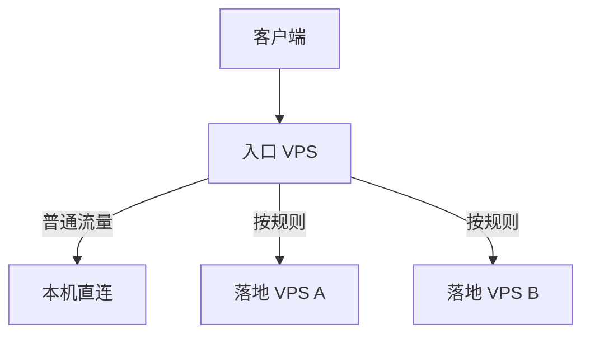

# sing-box Manager

面向 Debian / Ubuntu 的 sing-box 部署、节点管理、智能分流及维护工具。支持单 VPS、双 VPS 和多落地出站架构，不限制服务器所在地区。

**当前版本：v2.2.2** · 目标核心版本：sing-box 1.14.x · Bash / systemd

## 功能

- 独立代理、入口中转、落地服务三种初始化模式。
- Hysteria2、AnyTLS、VLESS REALITY 入站；落地机可选 SS2022。
- AnyTLS、Shadowsocks、Hysteria2 多中转出站，自定义标签。
- 自定义域名、IP 网段及远程规则集分流，支持规则增删改、排序、启停。
- 27 项预设规则集选项，支持逗号多选，添加时检测下载可用性。
- 智能分流、全局直连、全局中转模式及分流配置导入导出。
- 独立临时客户端测试中转和路由，避免占用正式缓存数据库。
- 配置备份、JSON 校验、启动失败回滚、权限修复、日志监控。
- ANSI 彩色中文自适应双列菜单，窄终端自动使用单列，支持 NO_COLOR。
- 中文服务状态、核心版本和分流状态栏；第 35 项或 `sb self-update` 更新管理器。

## 安装

建议使用 Debian 12/13 或 Ubuntu 22.04/24.04，要求 root、systemd、可访问软件仓库和 GitHub。容器型 VPS 需具备运行 sing-box 的权限。

先切换到 root（已是 root 则跳过）：

```bash
sudo -i
```

下载安装管理器（生产环境建议先审阅下载的脚本）：

```bash
curl -fsSL https://raw.githubusercontent.com/xiaoxya/sb-manager/main/sb.sh -o /tmp/sb.sh
bash -n /tmp/sb.sh && bash /tmp/sb.sh install-manager
```

新服务器安装核心及依赖（含 Python 3，菜单需要它）：

```bash
sb update
sb
```

核心使用 https://sing-box.app/install.sh 官方安装程序，未锁定版本。升级核心前请检查兼容性。

已有服务器仅需执行管理器安装命令即可升级脚本；不要重新初始化现有节点。替换旧管理器时会询问是否备份。

## 部署模式

| 模式 | 快捷命令 | 说明 |
| --- | --- | --- |
| 独立代理 | `sb init-standalone` | 单 VPS，本机直连，不需要落地机 |
| 入口中转 | `sb init-entry` | 客户端入口，可选择立即配置中转或稍后添加 |
| 落地服务 | `sb init-landing` | 接收中转及普通客户端连接 |

### 单 VPS

```bash
sb init-standalone
sb info
sb status
```

输入公网 IP 或域名、内部监听端口、TLS SNI、REALITY 目标域名，并按提示选择启用的入站。

### 双 VPS / 多落地 VPS



先在每台落地机安装管理器和核心，然后执行：

```bash
sb init-landing
sb info
curl -4fsS https://api.ipify.org; echo
```

记录公网地址、映射端口、AnyTLS 的 `relay-client` 用户密码、TLS SNI、SHA256 Base64 公钥指纹及实际公网出口 IP。

在入口机执行：

```bash
sb init-entry
sb relay
sb test-route
```

初始化时可选择配置落地节点，并选择是否启用 AI / Crypto / Web3 / TikTok 预设分流。中转测试通过后才应用配置。若暂不配置中转，默认本机直连；之后使用 `sb outbounds` 添加节点，使用 `sb rules` 管理规则。

### 默认端口

| 入站协议 | 独立 / 入口 | 落地 |
| --- | --- | --- |
| Hysteria2 (UDP) | 443 | 21196 |
| AnyTLS (TCP) | 59007 | 59007 |
| VLESS REALITY (TCP) | 443 | 不提供 |
| SS2022 (TCP/UDP) | 不提供 | 18834（可选） |

端口均可在初始化时调整（SS2022 仅落地机可选）。NAT VPS 必须在供应商面板配置对应协议的公网端口映射。若公网端口不同于内部监听端口，客户端分享链接需手动修改为公网端口。脚本不会配置上游防火墙；建议仅开放实际使用的端口。

## 主菜单

执行 `sb`：

```text
01 安装/更新核心         17 时间同步
02 初始化服务            18 系统诊断
03 启动                  19 前台调试
04 停止                  20 修复权限
05 重启                  21 备份
06 状态                  22 恢复 JSON
07 日志                  23 磁盘检查
08 节点信息              24 安全清理
09 修改监听端口          25 限制日志
10 出站节点管理          26 BBR 状态
11 修复规则下载          28 分流规则管理
12 中转测试              29 分流测试
13 日志级别              30 实时监控
14 REALITY 测试          31 域名统计
15 REALITY 公钥          32 AnyTLS 连接
16 TLS 目标              33 网卡速率
27 开机启动              34 公网地址
35 更新管理器
00 退出
```

## 出站节点管理

`sb outbounds` 或主菜单 10：

```text
01 查看出站详情       05 测试指定出站
02 添加出站           06 设置默认出站
03 修改出站           07 测试全部出站
04 删除出站           00 返回
```

添加节点时可使用 `relay-jp`、`relay-us` 等自定义标签，选择 anytls / shadowsocks / hysteria2，填写公网地址、端口及密码。TLS 协议需填写 SNI 和证书公钥指纹；HY2 可选 Salamander 混淆。输入预期出口 IP 可额外验证出口是否正确。

```bash
sb test-outbound relay-jp
sb test-outbound relay-jp 203.0.113.10
```

示例 IP 仅用于说明，请替换为真实出口。不能删除 direct；被活动配置或已保存策略引用的出站也不可删除。独立出站测试暂不支持链式 detour。

## 分流规则管理

`sb rules` 或主菜单 28：

```text
01 查看规则                13 设置默认出站
02 添加/修改/删除/排序规则  14 切换分流模式
05 启用/禁用规则           15 测试域名/IP
07 添加预设规则集          16 实时日志
08 自定义规则集管理        17 导入配置
                           18 导出配置
                           00 返回
```

02 和 08 进入同一个基础管理子菜单，支持查看、添加、修改、删除及排序规则，添加远程规则集、删除未引用规则集和设置默认出站。

### 自定义规则

| 匹配类型 | 示例 |
| --- | --- |
| domain | chatgpt.com |
| domain_suffix | openai.com |
| domain_keyword | netflix |
| domain_regex | ^api\\..* |
| ip_cidr | 203.0.113.0/24 |
| rule_set | geosite-ai |

多个匹配值使用英文逗号分隔。目标可选现有出站标签或 reject（拒绝）。规则索引从 0 开始，先匹配的终止规则优先。不要随意移除或移动基础嗅探、解析和私网拒绝规则；IP 匹配需注意域名解析位置。

例如将 Netflix 走日本出站：添加 domain_suffix 规则，匹配值 `netflix.com,nflxvideo.net,nflximg.net`，目标 `relay-jp`。

### 预设规则集

| 类别 | 选项 |
| --- | --- |
| AI | 01 AI 全部、02 OpenAI、03 Claude、04 Gemini |
| Crypto | 05 Crypto 全部、06 Binance、07 OKX、08 Web3 |
| 流媒体 | 09 TikTok、10 Netflix、11 YouTube、12 Disney+、13 Spotify、14 Twitch |
| 网络服务 | 15 Telegram、16 Twitter/X、17 Discord、18 GitHub、19 Google、20 Microsoft、21 Apple、22 Cloudflare |
| 其他 | 23 国外游戏、24 Speedtest、25 广告拦截、26 中国大陆域名、27 中国大陆 IP |

支持输入 `01,05,09` 批量选择同一目标出站，每项需确认。上游地址不可下载时会跳过；不保证全部预设在任何时刻均存在。重复添加可能产生重复路由规则，请先查看已有规则。

规则来源：[MetaCubeX/meta-rules-dat](https://github.com/MetaCubeX/meta-rules-dat)，默认更新周期 24h。

自定义远程规则集支持 HTTPS URL、binary (.srs) 或 source (.json) 格式。先添加唯一规则集标签，再添加 rule_set 匹配规则绑定目标出站。

### 分流模式

- smart：智能分流，恢复切换前保存的活动规则及默认出口。
- direct：全局本机直连。
- relay：全局指定中转出站。

切换全局模式保留基础嗅探、解析及私网拒绝规则。修改智能分流规则前应切回 smart。默认不配置中转失败时的自动直连回退。

### 导入 / 导出

导出包含 route.rules、route.rule_set、route.final 和策略元数据；默认文件为 /root/sb-routing-时间戳.json。

导入仅替换活动规则、规则集和默认出口，不导入禁用规则元数据，也不替换本机 DNS 或出站。迁移前应先配置对应出站标签及 HTTP Client，检查兼容性。导出的规则 URL 可能含访问令牌，请勿公开。

## 常用命令

| 命令 | 功能 |
| --- | --- |
| sb update | 安装 / 更新核心 |
| sb self-update | 从 GitHub 更新管理器（不更新核心或重启服务） |
| sb init | 初始化菜单 |
| sb init-standalone | 单机初始化 |
| sb init-entry | 入口初始化 |
| sb init-landing | 落地初始化 |
| sb start / stop / restart | 服务管理 |
| sb status | 服务状态 |
| sb logs | 实时日志 |
| sb info | 节点参数和分享链接 |
| sb port | 修改监听端口 |
| sb outbounds | 出站管理 |
| sb change-relay | 修改中转出站 |
| sb relay | 中转测试 |
| sb test-outbound 标签 [出口IP] | 指定出站测试 |
| sb rules | 分流管理 |
| sb test-route | 域名分流测试 |
| sb test | REALITY 本机测试 |
| sb monitor | 日志分类监控 |
| sb backup / restore | 备份 / 恢复 JSON |
| sb diagnose | 综合诊断 |
| sb fix-perm | 修复权限 |
| sb fix-rules | 修复规则下载配置 |
| sb disk / clean | 磁盘检查 / 清理 |

兼容旧命令 sb init-hk、sb init-tw。也可使用主菜单数字编号执行功能。

## 测试与监控

```bash
sb relay
sb test-route
sb monitor
```

分流测试创建独立临时 mixed 入站（127.0.0.1:10895）及缓存数据库，输入空格分隔的测试域名。输出 actual 为日志识别的出站标签，HTTP 为响应状态；policy=custom 不代表已自动判定预期规则。HTTP 000 表示未获得响应，401/403 可能是认证或服务端限制。临时入口可能影响入站相关规则匹配，最终以正式服务日志为准。

在落地机查看实时流量：

```bash
journalctl -u sing-box -n 0 -f -o cat
```

sb monitor 支持 all、ai、crypto、tiktok、anytls、relay-client（兼容 hk-relay）关键词过滤。用户名过滤取决于核心日志是否包含用户名。

菜单 31 统计历史连接目标出现次数（不是字节数），32 查看 AnyTLS TCP 连接，33 使用 nload 查看整张网卡流量。容器中无需强行使用 tcpdump。

## 配置与备份

```text
/usr/local/bin/sb
/etc/sing-box/
├── config.json
├── sb-host
├── sb-policy.json
└── cert/
    ├── fullchain.pem
    └── server.key
/var/lib/sing-box/cache.db
/root/sb-backups/
```

`sb backup` 备份 /etc/sing-box 整个目录；`sb restore` 仅恢复 config.json，证书、策略元数据和公网地址文件需手动核对恢复。配置修改会执行 sing-box check、备份、重启及失败时尝试回滚。备份包含敏感认证数据，务必妥善保存。

## 安全与已知限制

- 自签 ECDSA P-256 证书有效期 3650 天；已有完整证书会被复用。旧 privkey.pem 布局会阻止直接重新初始化。
- HY2/AnyTLS 分享链接使用 insecure=1 兼容部分客户端，建议手动配置公钥指纹校验；VLESS REALITY TCP 入站可生成完整分享链接，公钥由现有私钥计算。
- sb info 会显示认证信息，请勿公开输出或配置备份。
- 初始化会重新生成认证参数；已有 VPS 更新管理器时不要重新初始化。
- 当前版本不提供独立的入站增删菜单、规则名称、复杂组合规则、规则集强制更新或全面冲突检查。
- 目标为 sing-box 1.14.x，尚未完成真实多 VPS 联调及所有发行版验证。
- 清理日志、时间同步和前台调试可能影响系统其他功能或中断代理，请先阅读提示。
- 本仓库尚未声明开源许可证。

## 常见故障

```bash
sing-box check -c /etc/sing-box/config.json
sb status
journalctl -u sing-box -n 50 --no-pager
```

证书权限问题运行 sb fix-perm；规则下载配置问题运行 sb fix-rules；中转失败检查公网端口映射、密码、SNI、指纹和实际出口。不要在正式服务运行时使用相同缓存数据库启动第二个实例，使用 sb test-route 或菜单 19 前台调试。

## 项目链接

- [sing-box 官方文档](https://sing-box.sagernet.org/)
- [MetaCubeX 规则集](https://github.com/MetaCubeX/meta-rules-dat)
- [问题反馈](https://github.com/xiaoxya/sb-manager/issues)

## v2.2.1 界面与管理器更新

已有 v2.2.0 用户先按上方安装命令更新管理器；之后可执行 `sb self-update` 或选择主菜单 35。下载后执行 Bash 语法检查并提示备份替换。更新完成后退出旧菜单，再运行 `sb`。管理器更新不会主动修改代理配置或重启服务。

终端颜色默认自动检测，执行 `NO_COLOR=1 sb` 可使用纯文本菜单。终端宽度不足 90 列时自动使用单列。分流模式状态基于当前配置及保存的策略推断，不是实际流量测量。

## v2.2.2

`sb info`（菜单 08）新增 VLESS REALITY TCP 分享链接，自动读取 UUID、SNI、Flow、Short ID，并计算公钥。若公网端口与内部监听端口不同，请手动调整链接端口。未设置公网连接地址时先使用菜单 34 设置。非 TCP REALITY 暂不生成链接。
